

  

  
  

  

  Most of my work is private (employer and client projects), so this page is the map: what I do, what I use, and the public repos I can show.

  

  

## What I do

<b>🤖 LLM applications, agents &amp; generative AI</b>

 

- **Tool and function calling:** agents that call code, APIs and databases
- **RAG and vector databases:** answers grounded in the right documents
- **Prompt and context engineering,** including prompt optimization and Prompt Flow
- **Evals and guardrails:** measuring what an agent produces and keeping it inside limits
- **Multi-agent systems** and generative AI for text and video
- **Providers:** Claude, OpenAI, Gemini

 

<b>👁️ Computer vision &amp; edge AI</b>

 

- Object detection (YOLO), OCR (PaddleOCR), anomaly detection and vision-language models
- CNN models I train myself, see the public repos below
- Modbus TCP, Profinet and Siemens S7 PLCs, camera streams over MJPEG and WebSocket
- Optimizing models to run locally on NVIDIA Jetson Orin NX instead of in the cloud

 

<b>🚀 Production</b>

 

Docker, CI/CD with GitHub Actions, apps running on Google Cloud Run (plus AWS and Azure), monitoring and logging once it is live, and tests with pytest and Playwright.

 

<b>🧩 Backend &amp; apps</b>

 

Python services with FastAPI and SQLAlchemy, MySQL / MS SQL Server / SQLite, React + Vite + TypeScript interfaces, Flutter and React Native apps.

 

<b>🤝 Business development</b>

 

I also work on the business side: finding where AI actually helps a company (customer support, marketing and SEO, content), turning that into a scoped plan, and staying through delivery, since the engineering is mine as well.

 

## Work I can't show, but can talk about

These were made for an employer or a client, so there is no code or screenshot to show. Instead, this is the kind of work I do, and I would be glad to talk through the details in a conversation.

  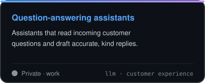
  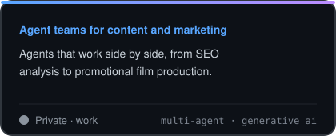
  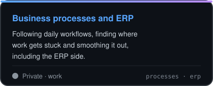

 

  

## Stack

**LLMs & agents** 

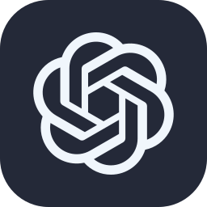

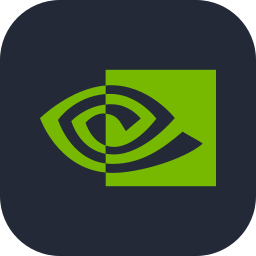

 

**ML & vision** 

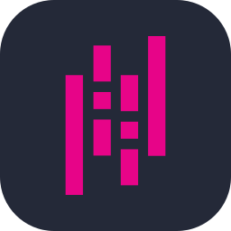
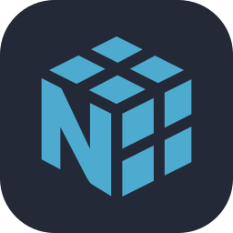

 

**Backend & data** 

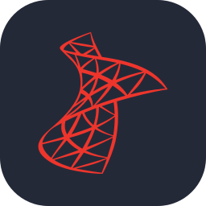

 

**Frontend, mobile & games** 

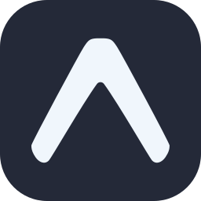

 

**Cloud, DevOps & testing** 

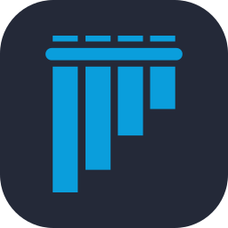
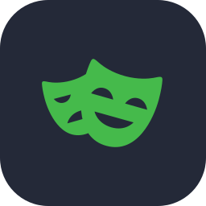

 

**Everyday tools** 

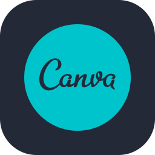

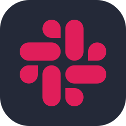

## Public projects

Two computer vision projects I built on my own, plus a Flask app I refactored and redesigned, with the code open.

  <a href="https://github.com/DeveloperHHT/Defect-Detection-using-Deep-Learning">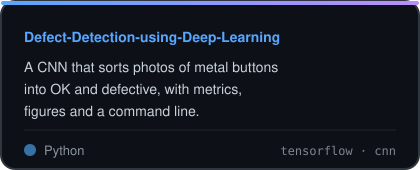</a>
  <a href="https://github.com/DeveloperHHT/Realtime-Handwritten-Digit-Recognition">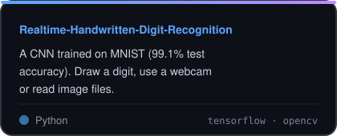</a>
  <a href="https://github.com/DeveloperHHT/Denpointment">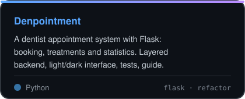</a>

 

  <picture>
    <source media="(prefers-color-scheme: dark)" srcset="https://raw.githubusercontent.com/DeveloperHHT/DeveloperHHT/output/snake-dark.svg" />
    
  </picture>

## Off duty

I play guitar and sing, and I ride. My music is on Spotify, Apple Music and YouTube Music.

  <a href="https://open.spotify.com/artist/1ESLAOiHre7ZBbjbfFN3VS"></a>
   
  
  
  
    
  <a href="https://instagram.com/bikerandvibes"></a>
   
  
    
  <a href="https://instagram.com/hhtthephotographer"></a>
   
  

  Have a role or a project that involves agents, computer vision or both? Message me on LinkedIn.

